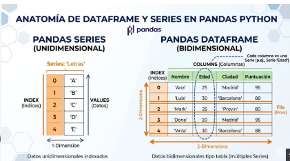
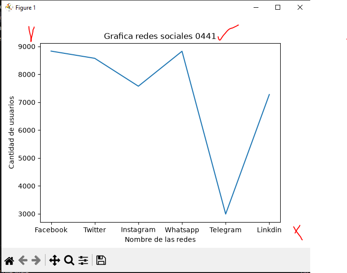
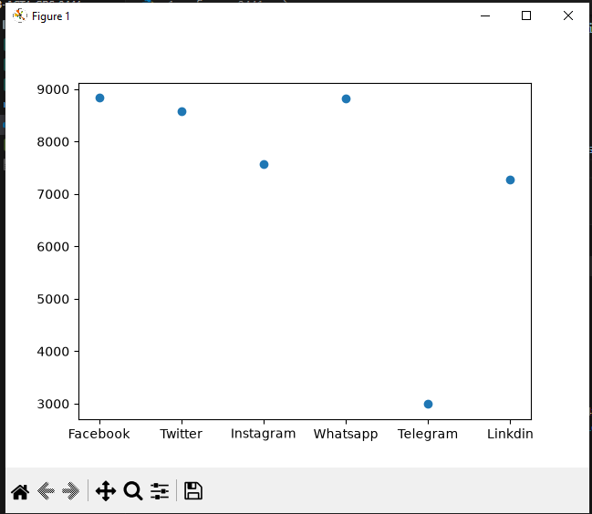
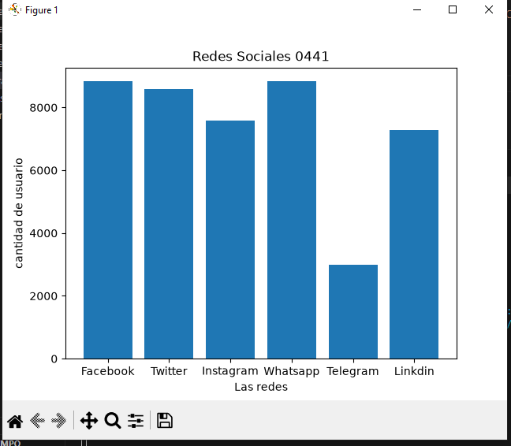
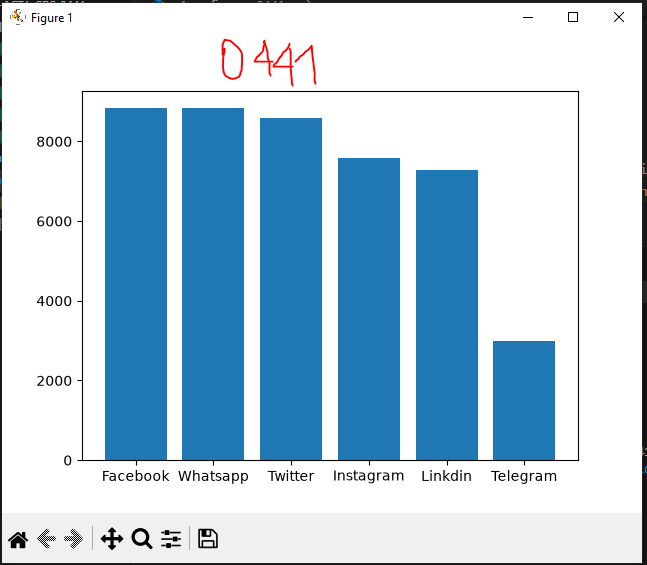
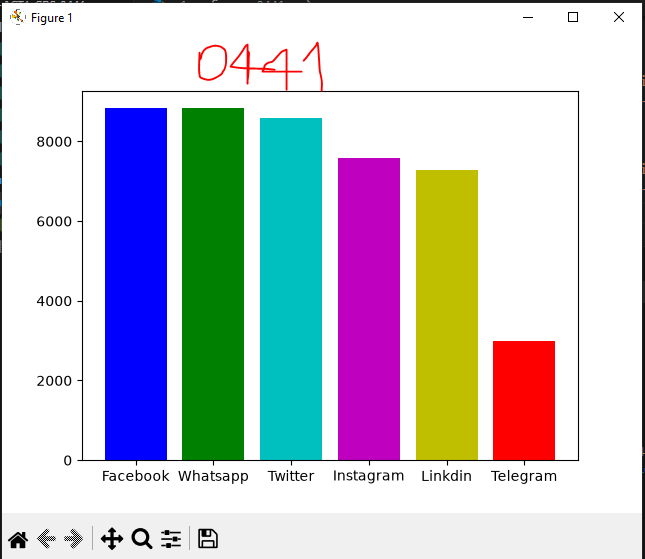
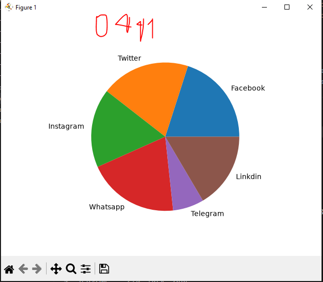

## dataframe o marco de datos en pandas

## redes sociales a nicel mundial

## GRafica de redes sociales

## grafica puntos

## grafica de barras de redes sociales

## grafica de barras del mas grande al mas chico Descendente

## coloreamos la grafica

## grafica de pastel o pie
